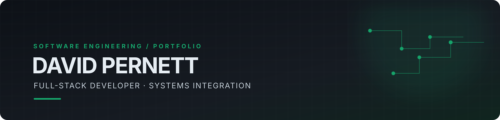

 

  

---

## 01 / About me · Sobre mí

<table>
<tr>
<td width="50%" valign="top">

### English

Software developer focused on building practical digital solutions across backend, frontend, APIs, databases, process automation and hardware integration.

I enjoy connecting applications, data and physical devices to solve real operational challenges.

</td>
<td width="50%" valign="top">

### Español

Desarrollador de software enfocado en construir soluciones digitales integrales: backend, frontend, APIs, bases de datos, automatización de procesos e integración de hardware.

Me interesa conectar aplicaciones, datos y dispositivos para resolver necesidades operativas reales.

</td>
</tr>
</table>

<b>⌘ What drives my work / Qué impulsa mi trabajo</b>

- Designing maintainable applications and backend services.
- Integrating APIs, databases and business systems.
- Exploring RFID technology and hardware-software communication.
- Turning operational processes into reliable software workflows.

---

## 02 / Tech stack · Tecnologías

**LANGUAGES**

**FRONTEND & BACKEND**

**DATABASES & TOOLS**

<b>View technologies by area / Ver tecnologías por área</b>

| Area | Technologies |
|---|---|
| Languages | Python, JavaScript, TypeScript, C#, SQL, HTML, CSS |
| Frontend | React, Vite |
| Backend | Django, Django REST Framework, .NET, REST APIs |
| Databases | PostgreSQL, SQLite, SQL Server |
| Desktop & hardware | PySide6, UHF RFID, reader SDK integration |
| Reporting | SSRS, RDL / RDLC, Stored Procedures |
| Tools | Git, GitHub, VS Code, Linux |

---

## 03 / Featured projects · Proyectos destacados

Selected work across software development, RFID, enterprise reporting and API integration.

<table>
<tr>
<td width="50%" valign="top">

### RFID / Desktop

**[LectorRFID_H661_Python](https://github.com/davidpernett19/LectorRFID_H661_Python)**

Desktop application for inventory management and traceability using UHF RFID technology.

Technical overview

- RFID reader communication through the H661 / UHF reader SDK.
- EPC tag capture and processing.
- Application services and repository structure.
- SQLite persistence and inventory workflows.

</td>
<td width="50%" valign="top">

### Enterprise / Full-stack

**LEMAN · CMMS-PYME**

Private project: computerized maintenance management platform for small and medium-sized businesses.

Technical overview

- React and TypeScript frontend.
- Django REST Framework backend.
- PostgreSQL data layer and JWT authentication.
- Asset management, maintenance requests and work orders.
- Role-based permissions and operational workflows.

</td>
</tr>
<tr>
<td width="50%" valign="top">

### Reporting / Data

**[Formatos-RDL](https://github.com/davidpernett19/Formatos-RDL)**

Collection of operational report definitions for maintenance and work-order processes.

Technical overview

- RDL / RDLC report definitions.
- Maintenance and equipment reporting.
- SQL-backed reporting artifacts.
- Legacy reporting environment compatibility.

</td>
<td width="50%" valign="top">

### Web / API integration

**[DigiAPI](https://github.com/davidpernett19/DigiAPI)** · **[DigiAPP-v2](https://github.com/davidpernett19/DigiAPP-v2)**

Web application experiments based on the Digimon universe, exploring API consumption and client-side integration.

Technical overview

- Browser-based application structure.
- JavaScript client-side functionality.
- API-oriented application experiments.

</td>
</tr>
</table>

<b>Enterprise systems integration / Integración de sistemas empresariales</b>

Experience working with enterprise inventory and maintenance workflows, including API-based data synchronization, SQL Server and operational reporting.

Some related projects and source code are private. Their implementation details and business information are intentionally not published here.

---

## 04 / GitHub activity · Actividad

 

<b>How to read these stats / Cómo interpretar estas estadísticas</b>

These cards are generated by external services using public GitHub activity. Their availability and refresh times depend on those services.

Estas tarjetas se generan mediante servicios externos a partir de actividad pública de GitHub. Su disponibilidad y actualización dependen de dichos servicios.

---

## 05 / Current focus · Enfoque actual

- Full-stack application development.
- Backend architecture and REST API design.
- RFID hardware integration and inventory automation.
- Database design, SQL and operational reporting.
- Software integration for real-world business processes.

---

## 06 / Contact · Conecta conmigo

  

Building practical software solutions. Connecting systems through technology.

 

